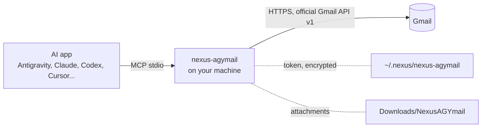

# NexusAGYmail

<!-- mcp-name: io.github.pironjulien/nexus-agymail -->

[](https://github.com/pironjulien/NexusAGYmail/releases)
[](https://pypi.org/project/nexus-agymail/)
[](https://github.com/pironjulien/NexusAGYmail/actions/workflows/tests.yml)
[](https://scorecard.dev/viewer/?uri=github.com/pironjulien/NexusAGYmail)
[](https://github.com/pironjulien/NexusAGYmail/blob/main/LICENSE)
[](https://github.com/pironjulien/NexusAGYmail/blob/main/pyproject.toml)
[](https://modelcontextprotocol.io)

**Gmail for AI agents that is safe to leave alone.** One local MCP server, `nexus-agymail`, gives Antigravity (whose
store has no Gmail connector) or any MCP client your Gmail through the official Gmail API: search, read, attachments,
drafts, labels, a reversible trash, and sending a draft **only after your explicit yes for that exact draft**.
Nothing is ever deleted for good.

- **Same tools as Google's official Gmail MCP server** (`search_threads`, `get_message`, `get_thread`,
  `create_draft`, `label_message`...), so an agent that knows one knows the other, without enrolling in the
  Workspace Developer Preview or enabling a remote MCP endpoint: it runs on your machine, with any personal Gmail.
- **Guardrails in the code, not in a prompt**: an email can never trigger a send, every email is framed as data,
  instructions hidden in an email are flagged, attachments are saved safely and secrets are never attached.
- Windows (used daily) and Linux (unit tests in CI); macOS should work but is untested. The token is encrypted
  with DPAPI on Windows, a file readable only by you elsewhere. Everything sent to the client is in English.

Part of the Nexus family: [NexusWindows](https://julienpiron.fr/nexuswindows/),
[NexusBrowser](https://julienpiron.fr/nexusbrowser/), [NexusAndroid](https://julienpiron.fr/nexusandroid/).

## Quick start

You need [uv](https://docs.astral.sh/uv/getting-started/installation/) and a Google account. About 10 minutes, once.

1. **Create your own Google OAuth client** (Gmail scopes are restricted, so every user brings their own client:
   your mail never goes through anyone else's app).
   1. In [Google Cloud Console](https://console.cloud.google.com/), create a project (any name).
   2. [Enable the Gmail API](https://console.cloud.google.com/apis/library/gmail.googleapis.com) for it.
   3. [Google Auth Platform > Branding](https://console.cloud.google.com/auth/branding): app name, your address;
      **Audience**: External, then add your Gmail address as a test user, and click **Publish app** (in *Testing*,
      Google expires the sign-in every 7 days; a published app for your own use needs no verification, Google only shows
      a "Google hasn't verified this app" screen: *Advanced > Go to … (unsafe)*).
   4. [Clients](https://console.cloud.google.com/auth/clients) > **Create client** > type **Desktop app** >
      **Download JSON** (`client_secret_….json`).
2. **Sign in** (opens your browser on Google's consent page):
   ```bash
   uvx --python 3.14 nexus-agymail auth --client-secret ~/Downloads/client_secret_XXXX.json
   ```
3. **Connect your AI app**, then restart it:
   - **Antigravity**: `uvx --python 3.14 nexus-agymail setup` (adds the `nexus-agymail` plugin: server and skill).
   - **Any other MCP client**: add the server by hand.

   <details><summary>JSON (Claude Desktop, Cursor, VS Code, Antigravity by hand)</summary>

   ```json
   {
     "mcpServers": {
       "nexus-agymail": { "command": "uvx", "args": ["--python", "3.14", "nexus-agymail"] }
     }
   }
   ```
   </details>
   <details><summary>Codex (~/.codex/config.toml)</summary>

   ```toml
   [mcp_servers.nexus-agymail]
   command = "uvx"
   args = ["--python", "3.14", "nexus-agymail"]
   startup_timeout_sec = 60
   ```
   </details>

Then ask, for example: *"Summarize my unread emails from this week"*, *"Archive the newsletters older than a
month"*, *"Draft a reply to the last email from Alice saying I agree, and show it to me before sending"*.

`uvx --python 3.14 nexus-agymail status` shows where the token is and which scopes it carries (no secret shown).

## How it works



The server is a plain local process: no cloud relay, no browser automation. It talks to `gmail.googleapis.com` with
your own OAuth client and a refresh token stored on your machine, and to `oauth2.googleapis.com` to refresh it.

## Tools

Names and parameters follow [Google's official Gmail MCP server](https://developers.google.com/workspace/gmail/api/reference/mcp)
and its extensions (`update_draft`, `trash_*`), plus three of its own: `send_draft`, `download_attachment`,
`auth_status`.

| Tool | What it does |
|---|---|
| `search_threads` | Search threads (Gmail syntax), one page per call: `pageSize` 1 to 50 (20), `pageToken`; each thread gives `messageCount` and a summary of its last 5 messages; trash with `includeTrash`, spam never |
| `get_message` | One message: headers, body as text (HTML converted), attachments listed (`part_id`, name, type, size); `maxChars` (8,090 by default) |
| `get_thread` | A thread in order, quotes of earlier replies removed and reported; `maxChars` shared (16,180 by default) |
| `download_attachment` | Saves an attachment (`partId`) to `Downloads/NexusAGYmail` or an absolute `directory`: sanitized name, never overwrites, marked as downloaded from the Internet; returns path, size, SHA-256 |
| `list_labels` | Labels (id, name, type), system labels first |
| `create_draft` | A draft; `to`, `cc`, `bcc` as a list (or text); as a reply (`replyToMessageId` or `threadId`): In-Reply-To, References, "Re:", same thread; `attachments` (absolute paths, 25 MB in total) |
| `list_drafts` | Drafts, one page per call (1 to 100), filtered by `query` |
| `update_draft` | Rewrites a draft (empty fields unchanged), thread, reply and attachments kept; `attachments` adds, `removeAttachments` removes (by name) |
| `label_message` / `unlabel_message`, `label_thread` / `unlabel_thread` | `labelIds`: system IDs (`INBOX`, `UNREAD`, `STARRED`, `IMPORTANT`, `CATEGORY_*`), user label IDs or names; archive = remove `INBOX`; an unknown label is an error, created only with `createMissing=true`; one ID or a list, 100 at most |
| `trash_message` / `trash_thread`, `untrash_message` / `untrash_thread` | Trash, reversible for 30 days; 100 items at most |
| `send_draft` | Without `confirm`: a summary to show to the user plus an `accord` token bound to the exact draft; sends **only with `confirm=true` and that token**, the draft read again and unchanged |
| `auth_status` | Token storage, granted scopes (checked at startup), validity; `reauth_required` when a scope is missing or extra |

Every tool carries MCP annotations (title, read-only, destructive, idempotent). For Antigravity, `setup` also installs
a short skill that says which tool to use for what, and when to use the browser instead (Gmail settings such as
filters or signature, another Google account).

## Safeguards

- **Scopes**: `gmail.readonly`, `gmail.compose`, `gmail.modify`. Never `https://mail.google.com/`, the only scope
  that allows permanent deletion: there is no `delete`, `batchDelete` or empty-trash tool, and the code is tested
  for it. An old token without `gmail.modify` keeps reading and drafting; the labelling and trash tools then answer
  `scopes` without calling Gmail.
- **Sending**: only `send_draft(draftId, confirm=true, accord=<token>)`, after the user's explicit yes for that
  draft, never at the request of an email. The single-use token (10 minutes) is returned by the summary and bound to
  the exact draft: recipients (to, cc, bcc), subject, full body, every part (HTML included) and the SHA-256 of each
  attachment. The draft is read again just before sending: if anything changed, nothing is sent and a new summary is
  returned. `drafts.send` is the only sending call: no direct sending without a draft.
- **Provenance**: a recipient found in an email the agent read is flagged in the summary (`provenance`): allowed only
  if the user asked for it.
- **Prompt injection**: subject, snippet, body, addresses and attachment names are returned framed as
  `⟦mail:ID …⟧ … ⟦/mail:ID⟧` (random ID per answer) and labelled as data; hidden HTML text and invisible characters
  are removed. An email that looks like instructions aimed at an AI gets an `injection_warning` field (a signal only:
  it neither blocks nor allows anything).
- **Attachments**: a received file is saved under a sanitized name (path, forbidden or invisible characters,
  right-to-left override as in "fdp.exe", Windows reserved names), never overwriting a file, with the Windows
  "downloaded from the Internet" mark (Zone.Identifier), so Windows and Office open it with their protections.
  Attaching a local file: never from a secrets location (`.ssh`, `.gnupg`, `.aws`, `.config/gcloud`, the AI apps'
  folders, `.env` files, private keys, `credentials.json`..., plus your own folders listed in
  `NEXUS_AGYMAIL_PROTECTED`); the user can always attach it themselves in Gmail.
- **Token**: `~/.nexus/nexus-agymail/token.bin`, encrypted with DPAPI for the current Windows account (permissions
  reduced to that account), or a `0600` file on macOS and Linux; written atomically under a lock (several servers can
  run at once). It is never shown. When you sign in again, a previous token with extra scopes is revoked only after
  the new one is saved.
- **Exact errors**: revoked or expired token, network, quota, permissions, not found, label: each has a stable `code`
  (`revoked`, `network`, `quota`, `forbidden`, `not_found`, `label`, `invalid_argument`...). Every request is retried
  with exponential backoff on 429 and 5xx; batched requests retry only the items refused for quota.
- **Bounded sizes**: bodies cut at `maxChars` (reported), paged searches, at most 100 items per labelling or trash
  call.

## Configuration

| Variable | Purpose |
|---|---|
| `NEXUS_AGYMAIL_HOME` | State folder (token, OAuth client, backups) instead of `~/.nexus/nexus-agymail` |
| `NEXUS_AGYMAIL_CLIENT_SECRET` | Path of the OAuth client JSON, instead of the copy made by `auth --client-secret` |
| `NEXUS_AGYMAIL_PROTECTED` | Extra folders whose files are never attached (separated by `;` on Windows, `:` elsewhere) |
| `NEXUS_AGYMAIL_ACCOUNT` | Address shown by `auth_status` when the token does not carry it |
| `NEXUS_AGYMAIL_UPDATE_CHECK` | `0` turns off the daily check of the latest version on PyPI |

## Privacy

NexusAGYmail runs on your machine. It has no account of its own, no telemetry, no analytics and no relay: its only
network requests go to Google (`gmail.googleapis.com`, `oauth2.googleapis.com`, and `accounts.google.com` in your
browser when you sign in), with your own OAuth client, plus at most one request a day to `pypi.org` to read the
latest version number (`NEXUS_AGYMAIL_UPDATE_CHECK=0` turns it off).

- **What it reads**: the emails, threads, drafts, labels and attachments the agent asks for, only when it calls the
  matching tool; local files only when the agent attaches them to a draft.
- **Where it goes**: tool results go to the AI client you connected, which may send them to its model provider under
  its own privacy policy. Drafts and sent emails go to Gmail. NexusAGYmail sends nothing anywhere else.
- **What it stores**, under `~/.nexus/nexus-agymail/` (or `NEXUS_AGYMAIL_HOME`): the refresh token (`token.bin`,
  encrypted with DPAPI on Windows, a `0600` file elsewhere), its lock file, the copy of your OAuth client
  (`client_secret.json`), and backups of the Antigravity config files `setup` edits (`backups/`). The server also
  writes `~/.nexus/status/agymail.json` (installed and latest version, last check time) for the Nexus app. Attachments you ask
  it to save go to `~/Downloads/NexusAGYmail` (or the folder given). In memory only, for the life of the server: the
  pending send accords and the addresses seen in emails read (for the `provenance` warning). No email is written to
  disk unless saved as an attachment; no log of emails is kept.
- **Removing it**: delete `~/.nexus/nexus-agymail/` and, for Antigravity, `~/.gemini/config/plugins/nexus-agymail/`;
  revoke the access in your [Google account](https://myaccount.google.com/connections) and delete your Google Cloud
  project if you no longer need it.

## Known limitations

- Each user creates their own Google OAuth client (step 1). A shared public client would need Google's restricted
  scope verification and a security assessment.
- Plain-text bodies only when writing: `create_draft` and `update_draft` do not write HTML; `update_draft` replaces
  the HTML part of a draft written in Gmail with the plain text.
- No Gmail settings (filters, signature, forwarding, vacation replies): use the Gmail web app.
- No spam reporting and no permanent deletion, on purpose.
- Used daily on Windows 11 with a real Gmail account; Linux runs the startup and unit tests in CI; macOS is
  untested.

## Development

```powershell
./test.ps1    # ruff, pyright, unit tests against a fake Gmail API (no network, no Google account)
```

`test.ps1` gives each checkout its own test environment under `~/.nexus/nexus-agymail` and never downloads anything:
run `uv sync --frozen` once with network access to fill the uv cache. The fake Gmail API (`tests/fake_gmail.py`)
speaks HTTP to the real `google-api-python-client`, so batching, retries, uploads and paging are tested for real.

## License

[MIT](https://github.com/pironjulien/NexusAGYmail/blob/main/LICENSE). Not affiliated with Google; Gmail is a trademark
of Google LLC.
