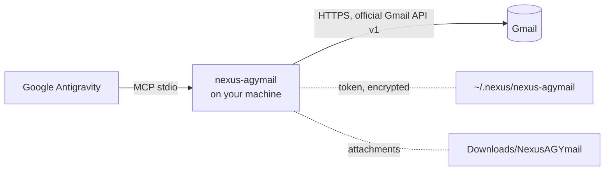

# NexusAGYmail


[](https://github.com/pironjulien/NexusAGYmail/releases)
[](https://github.com/pironjulien/NexusAGYmail/actions/workflows/tests.yml)
[](https://scorecard.dev/viewer/?uri=github.com/pironjulien/NexusAGYmail)
[](https://github.com/pironjulien/NexusAGYmail/blob/main/LICENSE)
[](https://github.com/pironjulien/NexusAGYmail/blob/main/native/NexusAGYmail.csproj)
[](https://modelcontextprotocol.io)

**Gmail for Google Antigravity, safe to leave alone.** Antigravity's store has no Gmail connector: one local MCP
server, `nexus-agymail`, gives it your Gmail through the official Gmail API: search, read, attachments, drafts,
labels, a reversible trash, and sending a draft **only after your explicit yes for that exact draft**. Nothing is
ever deleted for good.

- **Same tools as Google's official Gmail MCP server** (`search_threads`, `get_message`, `get_thread`,
  `create_draft`, `label_message`...), so an agent that knows one knows the other, without enrolling in the
  Workspace Developer Preview or enabling a remote MCP endpoint: it runs on your machine, with any personal Gmail.
- **Guardrails in the code, not in a prompt**: an email can never trigger a send, every email is framed as data,
  instructions hidden in an email are flagged, attachments are saved safely and secrets are never attached.
- Windows 10 and 11 (x64 and Arm64): one self-contained executable, nothing else to install (no Python, no .NET
  runtime). The token is encrypted with DPAPI for your Windows account. Everything sent to the client is in English.

Part of the Nexus family: [NexusWindows](https://julienpiron.fr/nexuswindows/),
[NexusBrowser](https://julienpiron.fr/nexusbrowser/), [NexusAndroid](https://julienpiron.fr/nexusandroid/).

**Install:** the [NexusSystem app](https://apps.microsoft.com/detail/9NSH2P3QLWT1) from the Microsoft Store
(`winget install --id 9NSH2P3QLWT1 --source msstore`), or ask your AI to install NexusAGYmail through it. By hand, see
below. New versions are no longer published to PyPI (0.13.0, the last Python version, stays available there).

## Quick start

You need Windows 10 or 11 and a Google account. About 5 minutes, once.

1. **Install, then run the guided sign-in** (PowerShell, no administrator rights). Download the release files, check
   them, then run the installer as a file:
   ```powershell
   $r = 'https://github.com/pironjulien/NexusAGYmail/releases/latest/download'
   Invoke-WebRequest "$r/get.ps1" -OutFile get.ps1
   Invoke-WebRequest "$r/SHA256SUMS.txt" -OutFile SHA256SUMS.txt
   (Get-FileHash get.ps1 -Algorithm SHA256).Hash   # must match the get.ps1 line of SHA256SUMS.txt
   gh attestation verify get.ps1 --repo pironjulien/NexusAGYmail   # optional: build provenance
   powershell -NoProfile -ExecutionPolicy Bypass -File .\get.ps1 -Auth
   ```
   It downloads the release for your PC (x64 or Arm64), checks it against the release's `SHA256SUMS.txt`,
   installs it in `~\.nexus\nexus-agymail\app\<version>`, adds the `nexus-agymail` plugin to Antigravity, then
   connects Gmail (without `-Auth`: install or update only). Gmail scopes are restricted, so
   every user creates their own free OAuth client in their own Google Cloud project: your mail never goes through
   anyone else's app. The assistant opens each Google page in your browser at the right place and says what to
   click (it first asks which Gmail address to connect, so the pages open on that account):
   1. create a project (name it NexusAGYmail);
   2. turn on the Gmail API;
   3. the consent screen (*Get started*, *External*); on *Branding*, a home page, a privacy policy link and an
      authorized domain (the assistant gives this repository, its [Privacy](#privacy) section and `github.com`:
      Google requires them before publishing); then **Publish app** (unpublished, Google blocks the sign-in with
      *Error 403: access_denied*);
   4. a client of type **Desktop app** (leave *Use this client for an AI-powered agent* unchecked), then **Download
      JSON**: the assistant finds the file in your Downloads folder by itself;
   5. sign in. Google shows "Google hasn't verified this app": it is your own app, click *Advanced > Go to
      NexusAGYmail (unsafe)*.

   Then it checks what can be checked: the Gmail API answers, and the app is really published (Google returns a
   7-day sign-in for apps left in *Testing*); if not, it opens the page that fixes it and signs in again.
2. **Restart Antigravity.**

   <details><summary>Antigravity by hand (mcp_config.json), if you skip setup</summary>

   ```json
   {
     "mcpServers": {
       "nexus-agymail": { "command": "<folder printed by get.ps1>\\NexusAGYmail.exe", "args": ["--mcp"] }
     }
   }
   ```
   </details>

Then ask, for example: *"Summarize my unread emails from this week"*, *"Archive the newsletters older than a
month"*, *"Draft a reply to the last email from Alice saying I agree, and show it to me before sending"*.

Already have a Desktop app client JSON? `NexusAGYmail.exe auth --client-secret <file>` skips the console steps.
`NexusAGYmail.exe status` shows where the token is and which scopes it carries, as JSON (no secret shown).
`NexusAGYmail.exe setup` declares the server to Antigravity again; `get.ps1 -Remove` removes it.

Each release attaches `NexusAGYmail-win-x64.zip`, `NexusAGYmail-win-arm64.zip`, an MCP bundle
(`nexus-agymail-<version>-win-x64.mcpb`), `SHA256SUMS.txt` and their build provenance: check a file with
`gh attestation verify <file> --repo pironjulien/NexusAGYmail`.

**Rather not create a client?** Google's own [Gmail MCP server](https://developers.google.com/workspace/gmail/api/reference/mcp)
runs on Google's side (same tool names) but is a developer preview: it needs the Google Workspace Developer Preview
Program and a Google Cloud project as well, and it cannot send. NexusAGYmail exists because Antigravity has no
Gmail connector of its own, and for confirmed sending.

## How it works



The server is a plain local process: no cloud relay, no browser automation. It talks to `gmail.googleapis.com` with
your own OAuth client and a refresh token stored on your machine, and to `oauth2.googleapis.com` to refresh it.

## Tools

Names and parameters follow [Google's official Gmail MCP server](https://developers.google.com/workspace/gmail/api/reference/mcp)
and its extensions (`update_draft`, `trash_*`), plus four of its own: `send_draft`, `list_new_messages`,
`download_attachment`, `auth_status`.

| Tool | What it does |
|---|---|
| `search_threads` | Search threads (Gmail syntax), one page per call: `pageSize` 1 to 50 (20), `pageToken`; each thread gives `messageCount` and a summary of its last 5 messages; trash with `includeTrash`, spam never |
| `get_message` | One message: headers, body as text (HTML converted), attachments listed (`part_id`, name, type, size); `maxChars` (8,090 by default) |
| `get_thread` | A thread in order, quotes of earlier replies removed and reported; `maxChars` shared (16,180 by default) |
| `list_new_messages` | Messages that arrived since the previous call (Gmail history, `users.history.list`), oldest first, without bodies: the position (`historyId`) is remembered per account and label (`labelId`, `INBOX` by default), the first call only sets it; `pageSize` 1 to 100 (20) with `more`, `advance=false` to peek, `startHistoryId` to resume from a returned position. History expired (about a week): the messages since the last check are found by date instead (`mode: catch_up`). Drafts, spam and trash never |
| `download_attachment` | Saves an attachment (`partId`) to `Downloads/NexusAGYmail` or an absolute `directory`: sanitized name, never overwrites, marked as downloaded from the Internet; returns path, size, SHA-256 |
| `list_labels` | Labels (id, name, type), system labels first |
| `create_label` | Creates a user label (`displayName`, `A/B` = nested), missing parents too unless `autoCreateParentLabels=false`; an existing label is returned as it is, system labels refused |
| `create_draft` | A draft; `to`, `cc`, `bcc` as a list (or text); as a reply (`replyToMessageId` or `threadId`): In-Reply-To, References, "Re:", same thread; `attachments` (absolute paths, 25 MB in total) |
| `list_drafts` | Drafts, one page per call (1 to 100), filtered by `query` |
| `get_draft` | One draft: recipients, subject, body as text, attachments, reply headers; `maxChars` (8,090 by default) |
| `update_draft` | Rewrites a draft (empty fields unchanged), thread, reply and attachments kept; `attachments` adds, `removeAttachments` removes (by name) |
| `label_message` / `unlabel_message`, `label_thread` / `unlabel_thread` | `labelIds`: system IDs (`INBOX`, `UNREAD`, `STARRED`, `IMPORTANT`, `CATEGORY_*`), user label IDs or names; archive = remove `INBOX`; an unknown label is an error, created only with `createMissing=true`; one ID or a list, 100 at most |
| `trash_message` / `trash_thread`, `untrash_message` / `untrash_thread` | Trash, reversible for 30 days; 100 items at most |
| `send_draft` | When the client supports MCP elicitation: opens the client's confirmation dialog with the draft and sends **only on the user's yes there**. Otherwise: a summary to show to the user plus an `accord` token bound to the exact draft, and sends **only with `confirm=true` and that token**. Either way the draft is read again and must be unchanged |
| `auth_status` | Token storage, granted scopes (checked at startup), validity; `reauth_required` when a scope is missing or extra |

Every tool carries MCP annotations (title, read-only, destructive, idempotent). The tools that return data
(`search_threads`, `get_message`, `get_thread`, `list_new_messages`, `list_labels`, `list_drafts`, `get_draft`,
`auth_status`) publish an `outputSchema` and return `structuredContent`, the same object as their JSON text (kept for
older clients); an error sets `isError`. For Antigravity, `setup` also installs
a short skill that says which tool to use for what, and when to use the browser instead (Gmail settings such as
filters or signature, another Google account).

## Safeguards

- **Scopes**: `gmail.readonly`, `gmail.compose`, `gmail.modify`. Never `https://mail.google.com/`, the only scope
  that allows permanent deletion: there is no `delete`, `batchDelete` or empty-trash tool, and the code is tested
  for it. An old token without `gmail.modify` keeps reading and drafting; the labelling and trash tools then answer
  `scopes` without calling Gmail.
- **Sending**: only `send_draft`, after the user's explicit yes for that draft, never at the request of an email:
  `send_draft(draftId, confirm=true, accord=<token>)`. Only a real `true` counts (not `1`, `"yes"` or `"on"`). The
  yes is a single-use
  accord (10 minutes) bound to the exact draft: each recipient with its role (to, cc, bcc kept apart), From,
  Reply-To, subject, full body, every part (HTML included), the SHA-256 of each attachment and of the draft's raw
  bytes. The draft is read once in raw format just before sending: if anything changed, nothing is sent and a new
  summary is returned. Otherwise those exact approved bytes are sent (`messages.send`, same thread). The draft is
  kept (delete it in Gmail if you like): `drafts.delete` is permanent, and an edit saved meanwhile would be lost. A
  change made after that last read can never go out in place of what was approved. A send is never retried after an
  ambiguous answer (5xx, timeout, network, unreadable 2xx, redirect): the outcome is reported as unknown.
  Each attempt is recorded before the request goes out, with its own ID, under the SHA-256 of the raw bytes
  (`envois.json`, nothing else kept), so it survives a crash and two simultaneous attempts never clear each other; the next summary or dialog of that same draft warns that it may already have been
  sent, after looking in Sent: "already sent" only when a sent message carries the draft's own Message-ID, otherwise
  at most "similar message, possible duplicate". A local storage failure never hides what Gmail did; if the attempt
  cannot be recorded, nothing is sent. No direct sending without a draft.
- **Provenance**: a recipient found in an email the agent read is flagged in the summary (`provenance`): allowed only
  if the user asked for it.
- **Prompt injection**: subject, snippet, body, addresses and attachment names are returned framed as
  `⟦mail:ID …⟧ … ⟦/mail:ID⟧` (random ID per answer) and labelled as data; hidden HTML text and invisible characters
  are removed. An email that looks like instructions aimed at an AI gets an `injection_warning` field (a signal only:
  it neither blocks nor allows anything).
- **Attachments**: a received file is saved under a sanitized name (path, forbidden or invisible characters,
  right-to-left override as in "fdp.exe", Windows reserved names), never overwriting a file, with the Windows
  "downloaded from the Internet" mark (Zone.Identifier), so Windows and Office open it with their protections.
  Attaching a local file: never from a secrets location (`.ssh`, `.gnupg`, `.aws`, `.config/gcloud`, the AI apps'
  folders, `.env` files, private keys, `credentials.json`..., plus your own folders listed in
  `NEXUS_AGYMAIL_PROTECTED`); the user can always attach it themselves in Gmail.
- **Token**: `~/.nexus/nexus-agymail/token.bin`, encrypted with DPAPI for the current Windows account (permissions
  reduced to that account); written atomically under a lock (several servers can run at once). It is never shown. When you sign in again, a previous token with extra scopes is revoked only after
  the new one is saved.
- **Exact errors**: revoked or expired token, network, quota, permissions, not found, label: each has a stable `code`
  (`revoked`, `network`, `quota`, `forbidden`, `not_found`, `label`, `invalid_argument`...).
- **Bounded sizes**: bodies cut at `maxChars` (reported), paged searches, at most 100 items per labelling or trash
  call.

## Configuration

| Variable | Purpose |
|---|---|
| `NEXUS_AGYMAIL_HOME` | State folder (token, OAuth client, backups) instead of `~/.nexus/nexus-agymail` |
| `NEXUS_AGYMAIL_CLIENT_SECRET` | Path of the OAuth client JSON, instead of the copy made by `auth --client-secret` |
| `NEXUS_AGYMAIL_PROTECTED` | Extra folders whose files are never attached (separated by `;`) |
| `NEXUS_AGYMAIL_ACCOUNT` | Address shown by `auth_status` when the token does not carry it |

## Privacy

NexusAGYmail runs on your machine. It has no account of its own, no telemetry, no analytics and no relay: its only
network requests go to Google (`gmail.googleapis.com`, `oauth2.googleapis.com`, and `accounts.google.com` in your
browser when you sign in), with your own OAuth client. The installer (`get.ps1`) downloads the release from GitHub.

- **What it reads**: the emails, threads, drafts, labels and attachments the agent asks for, only when it calls the
  matching tool; local files only when the agent attaches them to a draft.
- **Where it goes**: tool results go to the AI client you connected, which may send them to its model provider under
  its own privacy policy. Drafts and sent emails go to Gmail. NexusAGYmail sends nothing anywhere else.
- **What it stores**, under `~/.nexus/nexus-agymail/` (or `NEXUS_AGYMAIL_HOME`): the refresh token (`token.bin`,
  encrypted with DPAPI), its lock file, the copy of your OAuth client
  (`client_secret.json`), the position of `list_new_messages` per account and label (`history.json`: a Gmail
  `historyId` and the time of the last check, no email content), the sends whose outcome is unknown (`envois.json`:
  the SHA-256 of the raw bytes, the draft ID and the attempt time, no email content), and backups of the Antigravity config files `setup` edits (`backups/`). The server also
  writes `~/.nexus/status/agymail.json` (version, process, start time) for the Nexus app. Attachments you ask
  it to save go to `~/Downloads/NexusAGYmail` (or the folder given). In memory only, for the life of the server: the
  pending send accords and the addresses seen in emails read (for the `provenance` warning). No email is written to
  disk unless saved as an attachment; no log of emails is kept. A local usage journal
  (`~\.nexus\journal\agymail\<ai>\<YYYY-MM>.jsonl`) records one line per tool call: tool
  name, duration, outcome and a stable error code (`quota`, `network`...), never an address, subject, body, label, ID
  or query. It never leaves the PC; `NEXUS_JOURNAL=0` turns it off.
- **Removing it**: `get.ps1 -Remove` (or delete `~/.gemini/config/plugins/nexus-agymail/`), then delete
  `~/.nexus/nexus-agymail/`;
  revoke the access in your [Google account](https://myaccount.google.com/connections) and delete your Google Cloud
  project if you no longer need it.

## Known limitations

- Each user creates their own Google OAuth client (guided by `setup`). A shared public client would need Google's
  restricted scope verification and a security assessment.
- Plain-text bodies only when writing: `create_draft` and `update_draft` do not write HTML; `update_draft` replaces
  the HTML part of a draft written in Gmail with the plain text.
- No Gmail settings (filters, signature, forwarding, vacation replies): use the Gmail web app.
- No spam reporting and no permanent deletion, on purpose.
- Windows only (used daily on Windows 11 with a real Gmail account).
- No MCP elicitation dialog for sending: the yes always goes through the summary and the `accord` token. A read
  refused for quota (429) is not retried automatically: the tool answers `quota`.

## Development

The engine is C# on .NET 10 (`native/`, MimeKit for MIME), one self-contained executable per architecture. You need
the .NET 10 SDK.

```powershell
./test.ps1    # dotnet test: xUnit v3 suite, no network, no Google account
```

The suite (`tests/`) runs the engine over JSON-RPC on stdio against a fake Gmail API exposed only on loopback, with an
isolated home and fake credentials: tool contracts, paging, MIME, replies and attachments, exact approved send bytes,
concurrent draft edits, single-use accords, quota, lost, truncated or redirected send replies, secret files and
header injection refused. It also checks the sign-in against a fake Google (PKCE, state, revocation order), the
guided sign-in, `setup` in a temporary home, `get.ps1` on a local package under PowerShell 7 and Windows PowerShell
5.1, and recipient lists and attachment names over thousands of seeded inputs. Build and test outputs go to
`~\.nexus\build\nexusagymail`; `NEXUS_AGYMAIL_TEST_EXE` tests an executable already built. `tools/package.ps1 -Version
X.Y.Z` builds the release files locally; a `vX.Y.Z` tag builds, attests and publishes them (`release.yml`).

## License

[MIT](https://github.com/pironjulien/NexusAGYmail/blob/main/LICENSE). Not affiliated with Google; Gmail is a trademark
of Google LLC.
